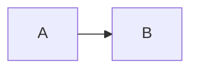

# Migration to v4

> **Applies to the upcoming 4.x release (not yet published).** The current npm
> release is 3.0.5 and bundles Mermaid 11. The changes below take effect after
> upgrading to 4.x; publishing this guide does not upgrade installed packages.

Version 4 bundles Mermaid `~12.2.0`. This is a major release because Mermaid's
public configuration types remove `defaultRenderer`. It also adopts Mermaid 12's
ES2024 / Safari 17.4+ requirements. Layout, geometry, and dimensions remain outside
the package's rendering contract.

Node.js `>=22.19.0`, Nuxt `^4.1.0`, and Nuxt Content `>=3.5.0 <4.0.0` are unchanged.
After 4.0 is published, install `@barzhsieh/nuxt-content-mermaid@^4` to opt in.
An application's `^3.x` range does **not** receive Mermaid 12 automatically.

## Replace defaultRenderer with layout

Remove `flowchart.defaultRenderer`, `class.defaultRenderer`, and
`state.defaultRenderer` from all three package configuration sources:

| Source | Where to update | Scope of top-level `layout` |
| --- | --- | --- |
| Page Mermaid Config | The Content page's `config` frontmatter / `pageConfig` prop | Supporting diagrams on that page |
| Direct Mermaid Config | The component's `config` prop | That component instance |
| Runtime Mermaid Config | `contentMermaid.loader.init` or `runtimeConfig.public.contentMermaid.loader.init` | Application-wide shared default |

Select `layout: 'dagre'` for dagre rendering (the intent of the legacy
`'dagre-wrapper'` value), or explicitly select `layout: 'elk'` to request ELK.
Keep other diagram options in their existing object.

Mermaid 12 resolves `layout` per diagram type as well as globally. The
one-to-one replacement for `flowchart.defaultRenderer: 'elk'` is
`flowchart: { layout: 'elk' }`, which keeps the choice limited to flowcharts.
A top-level `layout` instead applies to every supporting diagram type in that
source's scope (flowchart, class, state, ER, requirement, use case). Precedence,
highest first: the diagram's own fence frontmatter or directive, then this
module's Runtime / Page / Direct configuration, then the diagram type's default,
then the global default; at the same layer a diagram-scoped key wins over a
global one. This module merges Runtime, Page, and Direct configuration into that
single layer, so a diagram-type key set in any of them (for example
`flowchart.layout` in `loader.init`) beats a top-level `layout` set in another;
the same holds for a diagram-type `theme`, which bypasses the module's light/dark
theme switching for that type.

This applies to diagram types that support the selected layout, such as flowchart,
class, state, and ER; not every Mermaid diagram type supports ELK.

```yaml
# Legacy Page Mermaid Config
config:
  flowchart:
    defaultRenderer: elk
    curve: basis
```

```yaml
# Keep the choice flowchart-only (one-to-one migration)
config:
  flowchart:
    layout: elk
    curve: basis
```

```yaml
# Opt into ELK for supporting diagrams across this Content page
config:
  layout: elk
  flowchart:
    curve: basis
```

To select ELK for just one diagram, use Direct Mermaid Config on that instance:

```vue
<Mermaid :config="{ layout: 'elk' }" :code="code" />
```

Alternatively, put Mermaid frontmatter inside that diagram's code fence. This is
single-diagram source configuration, distinct from Content page frontmatter:

````markdown

````

For runtime defaults:

```ts
export default defineNuxtConfig({
  contentMermaid: {
    loader: { init: { layout: 'dagre', look: 'classic' } },
  },
})
```

Mermaid 12 silently ignores the old keys at runtime. This module preserves the
input and warns in development once per **source × field per page load**, even
with multiple diagrams or repeated renders. Production builds remove this
warning. No automatic conversion occurs. Mermaid 12 itself defaults to ELK with the
`neo` look and the `redux-color` theme; this module keeps `dagre`, `classic`, and
its default/dark theme policy, so ELK requires an explicit `layout: 'elk'` at top
level or inside the diagram type's section.

The warning covers only the three package configuration sources above. A
diagram's own fence frontmatter or `%%{init: ...}%%` directive can carry the same
keys, and Mermaid 12 ignores them there too, without any warning. Search the
Markdown content as well and apply the same `layout` replacement inside the
diagram source:

```bash
grep -rn "defaultRenderer" content/
```

The module defaults to `layout: 'dagre'` and `look: 'classic'`, and keeps
`mindmap.layout: 'cose-bilkent'` and `swimlane.layout: 'swimlane'` explicitly,
because a top-level layout would otherwise override those diagram types' own
defaults. Package Users can override any of these. The existing default/dark theme
policy is unchanged. ELK is loaded only when a diagram selects `layout: 'elk'`.

## Fix TS2353 in configuration literals

Mermaid 12's types reject the removed properties. For example,
`{ flowchart: { defaultRenderer: 'elk' } } satisfies PageMermaidConfig` produces
TS2353 (an unknown property). Replace it with
`{ flowchart: { layout: 'elk' } } satisfies PageMermaidConfig`, or with top-level
`{ layout: 'elk' }` when every supporting diagram type should use ELK. Apply the
same fix to Direct
Mermaid Config and `loader.init`; do not cast away the error as a migration.
The package does not add a compatibility type layer for the removed fields.

## Check reader browsers

4.x is the first line to declare this package's browser floor explicitly.
3.x did not specify a minimum Safari version and did not guarantee support for
all older browsers. The higher requirement comes from the Mermaid 11-to-12
upstream change; it is not a comparison with a previously declared package floor.

Mermaid 12 targets ES2024 and Safari 17.4+, including iOS / iPadOS 17.4+
([upstream requirements](https://github.com/mermaid-js/mermaid/blob/1fb7869866dd619168d840291c9c54b4f129758b/packages/mermaid/src/docs/config/usage.md#L27-L33)).
iOS / iPadOS 17.4 shipped on [March 5, 2024](https://support.apple.com/en-us/HT214081);
macOS Safari 17.4 shipped on [March 7, 2024](https://support.apple.com/en-us/120894).
Readers staying on older systems may need an OS update to obtain a supported
Safari version. Older browsers fall outside this contract even if some diagrams work.

Syntax transforms and API polyfills solve different problems. Lowering a build
target does not supply missing APIs. In a production browser probe with
`Object.groupBy` removed, a flowchart rendered, but loading the usecase parser
failed. The module handled that failure as a diagram error; surrounding page
content and Vue interactions still worked. Injecting a lazy-module SyntaxError
also reached diagram error handling. These probes are not an emulation of an
older Safari, and cannot guarantee the whole application's compatibility.

Applications that require older browsers must supply and verify the necessary
transforms / polyfills themselves, or remain on 3.x and verify their application's
browser behavior. Real Safari 17.4 and physical iOS devices have not been verified.
Source shown in an error slot may be clipped
by existing CSS; this separate limitation is tracked in [#145](https://github.com/andy820621/nuxt-content-mermaid/issues/145).

## Review diagram dimensions

The defaults select dagre layout and the classic look. They do not freeze
spacing, labels, SVG dimensions, or geometry across Mermaid versions. Review diagrams
inside constrained layouts and update application-owned visual snapshots.
Byte-identical SVG and geometry are not package compatibility guarantees.

## 3.x becomes frozen

On 4.0 publication, 3.x remains installable but receives no dependency updates,
compatibility expansion, features, or ordinary fixes. The first three months
prioritize migration documentation, guidance, and 4.x defects blocking migration.
Critical package-caused security backports are considered individually.
See the [4.x dependency and migration contract](./DEPENDENCY_AND_MIGRATION_CONTRACT_V4.md).
