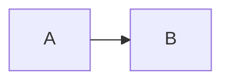

# 升級至 v4

> **適用於即將推出的 4.x（尚未發布）。** 目前 npm 正式版為 3.0.5，綁定 Mermaid 11。下列變更在升級至 4.x 後才生效；刊出本指南不會更新已安裝的套件。

第 4 版綁定 Mermaid `~12.2.0`。這次採用 major，是因為 Mermaid 公開設定型別移除了 `defaultRenderer`；同時採用 Mermaid 12 的 ES2024／Safari 17.4+ 需求。Layout、geometry 與 dimensions 仍在套件渲染契約之外。

Node.js `>=22.19.0`、Nuxt `^4.1.0` 與 Nuxt Content `>=3.5.0 <4.0.0` 不變。4.0 發布後，安裝 `@barzhsieh/nuxt-content-mermaid@^4` 才會切換至新引擎；應用程式的 `^3.x` 範圍**不會**自動取得 Mermaid 12。

## 將 defaultRenderer 改為 layout

請從三種設定來源移除 `flowchart.defaultRenderer`、`class.defaultRenderer` 與 `state.defaultRenderer`：

| 來源 | 修改位置 | 頂層 `layout` 的作用範圍 |
| --- | --- | --- |
| Page Mermaid Config | Content 頁面的 `config` frontmatter／`pageConfig` prop | 該頁支援此 layout 的圖表 |
| Direct Mermaid Config | 元件的 `config` prop | 該元件實例 |
| Runtime Mermaid Config | `contentMermaid.loader.init` 或 `runtimeConfig.public.contentMermaid.loader.init` | 應用程式共用預設 |

若要使用 dagre（舊 `'dagre-wrapper'` 值的設定意圖），請選 `layout: 'dagre'`；若要使用 ELK，請明確選 `layout: 'elk'`。其他圖種選項留在原物件內。

Mermaid 12 除了全域設定，也會按圖種解析 `layout`。`flowchart.defaultRenderer: 'elk'` 的一對一替代寫法是 `flowchart: { layout: 'elk' }`，選擇範圍仍只限 flowchart。頂層 `layout` 則套用到該來源範圍內所有支援的圖種（flowchart、class、state、ER、requirement、use case）。優先序由高到低：該圖自己的圍欄 frontmatter 或 directive，接著是本模組的 Runtime／Page／Direct 設定，再來是該圖種的預設值，最後是全域預設值；同一層中，圖種範圍的鍵優先於全域鍵。本模組會把 Runtime、Page、Direct 設定合併成同一層，因此其中任一來源設定的圖種鍵（例如 `loader.init` 的 `flowchart.layout`）會優先於另一來源的頂層 `layout`；圖種的 `theme` 也一樣，會讓該圖種繞過模組的深淺色主題切換。

這裡指支援所選 layout 的圖種，例如 flowchart、class、state 與 ER；並非每種 Mermaid 圖表都支援 ELK。

```yaml
# 舊 Page Mermaid Config
config:
  flowchart:
    defaultRenderer: elk
    curve: basis
```

```yaml
# 只讓 flowchart 選用 ELK（一對一遷移）
config:
  flowchart:
    layout: elk
    curve: basis
```

```yaml
# 此 Content 頁面中支援 ELK 的圖表都選用 ELK
config:
  layout: elk
  flowchart:
    curve: basis
```

若只要讓單張圖選用 ELK，請在該元件實例使用 Direct Mermaid Config：

```vue
<Mermaid :config="{ layout: 'elk' }" :code="code" />
```

也可把 Mermaid frontmatter 放在該圖的程式碼圍欄內。這是單圖原始碼設定，與 Content 頁面的 frontmatter 不同：

````markdown

````

執行階段預設值：

```ts
export default defineNuxtConfig({
  contentMermaid: {
    loader: { init: { layout: 'dagre', look: 'classic' } },
  },
})
```

Mermaid 12 在執行期會直接忽略舊鍵。本模組保留輸入，並在開發模式對每個「**來源 × 欄位**」於整頁載入期間只提示一次；多張圖或重新 render 不會重複提示。Production 建置會移除警告。模組不會自動轉換。Mermaid 12 本身預設為 ELK、`neo` 外觀與 `redux-color` 主題；本模組維持 `dagre`、`classic` 與 default／dark 主題策略，因此要選用 ELK 必須在頂層或該圖種的區段內明確設定 `layout: 'elk'`。

開發警告只涵蓋上述三種套件設定來源。圖表自己的圍欄 frontmatter 或 `%%{init: ...}%%` directive 也可能帶有相同的鍵，Mermaid 12 同樣會忽略，而且不會有任何警告。請一併搜尋 Markdown 內容，並在圖表原始碼內改用相同的 `layout` 寫法：

```bash
grep -rn "defaultRenderer" content/
```

本模組預設 `layout: 'dagre'` 與 `look: 'classic'`，並明確保留 `mindmap.layout: 'cose-bilkent'` 與 `swimlane.layout: 'swimlane'`，否則頂層 layout 會覆蓋這兩種圖的原生預設。使用者可以覆寫以上任一項。既有 default／dark 主題策略不變；只有圖表選用 `layout: 'elk'` 時才載入 ELK。

## 修正設定 literal 的 TS2353

Mermaid 12 的型別不再接受舊欄位。例如 `{ flowchart: { defaultRenderer: 'elk' } } satisfies PageMermaidConfig` 會產生 TS2353（未知屬性）。請改成 `{ flowchart: { layout: 'elk' } } satisfies PageMermaidConfig`；若所有支援的圖種都要用 ELK，再改用頂層 `{ layout: 'elk' }`。Direct Mermaid Config 與 `loader.init` 使用相同修法；請勿以型別轉換掩蓋遷移需求。本套件不提供舊欄位的型別相容層。

## 檢查讀者的瀏覽器

4.x 是本套件首次明確宣告瀏覽器最低版本的系列。3.x 沒有明列 Safari 最低版本，也不代表保證支援所有舊瀏覽器。這次門檻提高是相對 Mermaid 11 升至 12 的上游需求，並非與本套件先前明列的瀏覽器門檻相比。

Mermaid 12 的目標為 ES2024／Safari 17.4+，包含 iOS／iPadOS 17.4+（[上游需求](https://github.com/mermaid-js/mermaid/blob/1fb7869866dd619168d840291c9c54b4f129758b/packages/mermaid/src/docs/config/usage.md#L27-L33)）。iOS／iPadOS 17.4 於 [2024-03-05](https://support.apple.com/en-us/HT214081) 發布；macOS Safari 17.4 於 [2024-03-07](https://support.apple.com/en-us/120894) 發布。停留在舊系統的讀者，可能需要更新 OS 才能取得受支援的 Safari。舊瀏覽器即使能顯示部分圖表，也不在此契約內。

語法轉譯與 API polyfill 解決不同問題；降低 build target 不會補上缺少的 API。正式建置的瀏覽器測試移除 `Object.groupBy` 後，flowchart 仍能渲染，但 usecase parser 載入失敗。模組將失敗處理為圖表錯誤，周圍頁面內容與 Vue 互動仍正常。對延遲載入模組注入 SyntaxError，也能進入圖表錯誤處理。這些測試不是舊版 Safari 的等效模擬，不能保證整個應用程式的相容性。

需要支援更舊瀏覽器的應用程式，必須自行提供並驗證所需轉譯／polyfill，或保留 3.x 並驗證應用程式的瀏覽器行為。尚未驗證真實 Safari 17.4 與 iOS 實體裝置。錯誤 slot 的原始碼可能被既有 CSS 裁切；此獨立限制追蹤於 [#145](https://github.com/andy820621/nuxt-content-mermaid/issues/145)。

## 檢查圖表尺寸

預設使用 dagre 排版與 classic 外觀；這不會固定跨 Mermaid 版本的間距、標籤、SVG 尺寸或 geometry。請檢查有尺寸限制的版面，並更新應用程式自己的視覺快照。精確 SVG 與 geometry 不屬於套件相容性保證。

## 3.x 凍結

4.0 發布後，3.x 仍可安裝，但不再更新相依、擴張相容性、增加功能或提供一般修正。前三個月優先提供遷移文件、使用指引，以及阻礙遷移的 4.x 缺陷修正。由套件引起的嚴重安全問題，會個案考慮 backport。詳見 [4.x 相依與遷移契約](https://github.com/andy820621/nuxt-content-mermaid/blob/main/docs/ch/DEPENDENCY_AND_MIGRATION_CONTRACT_V4.md)。
